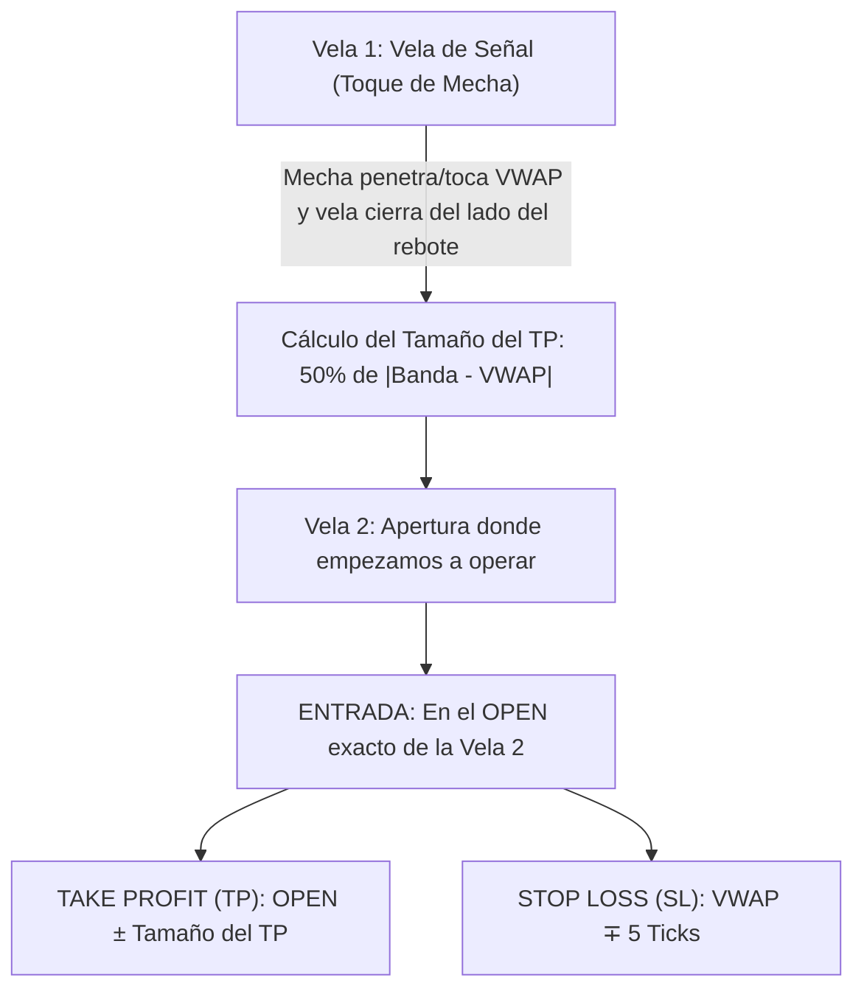

# TradeAccion: Sistema Cuantitativo Intradía para Futuros CME (TopstepX)

Sistema institucional automatizado de trading intradía para futuros de CME Group (`ES`, `NQ`, `CL`, `YM`) operando a través de la API oficial de **TopstepX** (`api.topstepx.com`), optimizado para superar y fondear cuentas de evaluación y Express Funded de **Topstep ($150,000 USD)**.

---

## 1. Tesis y Estrategia Cuantitativa

El sistema se basa en la absorción institucional y reversión a la media intradiaria sobre el **Session VWAP** con **Bandas de Desviación Estándar ($\pm 1\sigma$)** en velas de **30 minutos (M30)**:



### Reglas de Ejecución:
1. **Detección de Señal (Vela 1 - Vela de Rechazo con Mecha):**
   - **Compras (BUY):** La mecha penetra o toca el VWAP (`Low <= VWAP`), pero la vela cierra por encima (`Close > VWAP`) confirmando la defensa institucional de compradores.
   - **Ventas (SELL):** La mecha penetra o toca el VWAP (`High >= VWAP`), pero la vela cierra por debajo (`Close < VWAP`) confirmando absorción de vendedores.
2. **Entrada al Mercado (Vela 2):**
   - Se ejecuta orden de entrada exactamente en la **Apertura (`Open`)** de la vela inmediatamente posterior.
3. **Take Profit (TP):**
   - El tamaño del objetivo es exactamente el **50% de la distancia entre el VWAP y la Banda $\pm 1\sigma$**:
     $$\text{Tamaño TP} = 0.5 \times |\text{Banda} - \text{VWAP}|$$
   - Se proyecta directamente desde el precio de **Apertura**:
     - Long: $\text{TP} = \text{Open} + \text{Tamaño TP}$
     - Short: $\text{TP} = \text{Open} - \text{Tamaño TP}$
4. **Stop Loss (SL):**
   - Blindado a exactamente **5 ticks del VWAP** de la señal:
     - Long: $\text{SL} = \text{VWAP} - (5 \times \text{Tick Size})$
     - Short: $\text{SL} = \text{VWAP} + (5 \times \text{Tick Size})$

---

## 2. Resultados del Backtest Oficial (Últimos 3 Meses | 2 Contratos)

Simulación sobre datos de velas de 30 minutos descargados directamente de la **API oficial de TopstepX** entre agosto y noviembre de 2026, operando **2 contratos por trade** y con comisiones de broker descontadas:

### Resumen por Activo

| Símbolo | Nombre del Activo | Trades | Win Rate | Ganancia Bruta | Pérdida Bruta | Comisiones | Beneficio Neto | Factor |
| :--- | :--- | :---: | :---: | :---: | :---: | :---: | :---: | :---: |
| **CL** | Petróleo WTI | 155 | 60.6 % | +$43,920.00 | -$19,960.00 | -$1,240.00 | **+$22,720.00** | 2.20 |
| **NQ** | E-mini Nasdaq 100 | 70 | 52.9 % | +$29,640.00 | -$8,080.00 | -$560.00 | **+$21,000.00** | 3.67 |
| **ES** | E-mini S&P 500 | 185 | 67.0 % | +$34,650.00 | -$18,825.00 | -$1,480.00 | **+$14,345.00** | 1.84 |
| **YM** | Micro Dow Jones | 111 | 60.4 % | +$1,536.00 | -$656.00 | -$333.00 | **+$547.00** | 2.34 |
| **TOTAL** | **Portafolio Combinado** | **521** | **61.8 %** | **+$109,746.00** | **-$47,521.00** | **-$3,613.00** | **+$58,612.00 USD** | **2.31** |

### Métricas de Rendimiento y Reglas Topstep ($150,000):
- **Tasa de Jornadas Ganadoras:** **39 días positivos (81.2%)** frente a 9 negativos (18.8%).
- **Peor Jornada Registrada:** **-$949.00 USD** (15 de Septiembre). El límite de pérdida diaria de Topstep es de **-$3,000.00 USD**, por lo que el sistema jamás estuvo en riesgo de bloqueo.
- **Consistencia Topstep:** Ninguna jornada superó el 7% de la ganancia total acumulada (límite máximo permitido por la firma: 50%).

---

## 3. Arquitectura del Proyecto

```
TradeAccion/
├── adapters/
│   └── topstepx_client.py       # Conexión REST & WebSocket con api.topstepx.com
├── core/
│   ├── vwap_bands.py            # Motor de cálculo incremental de Session VWAP y Bandas
│   ├── strategy.py              # Generación de señales, SL a 5 ticks y TP al 50% de banda
│   ├── schedule_guardian.py     # Filtro de horarios CME, pausas de mantenimiento y corte 15:05 CT
│   ├── risk_guardian.py         # Control de drawdown, DLL y límites de Topstep
│   └── engine.py                # Orquestador asíncrono multi-activo
├── ui/
│   ├── static/                  # CSS y visualizador de mercado HTML5 Canvas
│   └── templates/index.html     # Dashboard Web profesional institucional en Dark Mode
├── backtest_unlimited.py        # Backtest oficial multi-símbolo 3 meses sin límites diarios
├── generate_daily_table.py      # Generador del desglose completo día por día
├── test_system.py               # Suite de tests unitarios automáticos
├── server.py                    # Servidor web FastAPI + WebSockets
├── config.py                    # Configuración centralizada de activos y cuentas
├── .env.example                 # Plantilla de variables de entorno seguras
└── requirements.txt             # Dependencias del proyecto
```

---

## 4. Instalación y Puesta en Marcha

### Prerrequisitos:
- Python 3.10 o superior instalado.

### 1. Clonar el repositorio:
```bash
git clone https://github.com/Jonathanc1923/TradeAccion.git
cd TradeAccion
```

### 2. Instalar dependencias:
```bash
pip install -r requirements.txt
```

### 3. Configurar credenciales:
Crea un archivo `.env` basado en `.env.example`:
```ini
TOPSTEPX_API_KEY=tu_api_key_de_topstepx
TOPSTEPX_USERNAME=tu_email_de_topstep
SERVER_HOST=0.0.0.0
SERVER_PORT=8000
```

### 4. Ejecutar tests del sistema:
```bash
python test_system.py
```

### 5. Iniciar Servidor y Dashboard Web:
```bash
python server.py
```
Abre tu navegador en `http://localhost:8000` para monitorear el balance en tiempo real, estado de los activos, señales y alertas de riesgo.

### 6. Ejecutar Backtests:
```bash
# Backtest consolidado de 3 meses a 2 contratos
python backtest_unlimited.py

# Generar reporte detallado día por día
python generate_daily_table.py
```

---

## 5. Licencia
Proyecto desarrollado para uso privado e institucional. Todos los derechos reservados.
